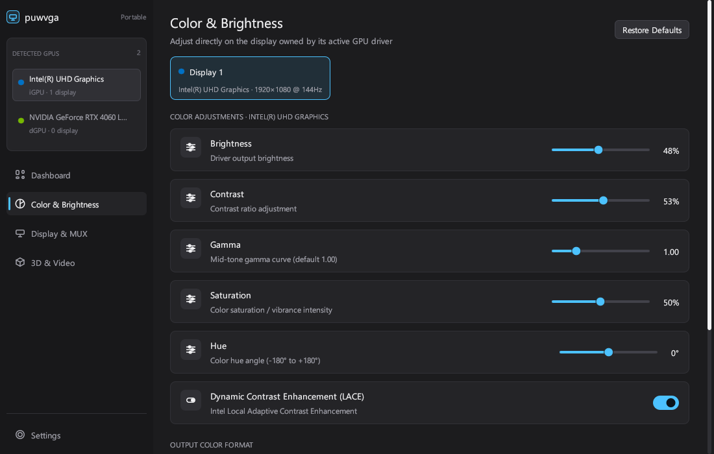
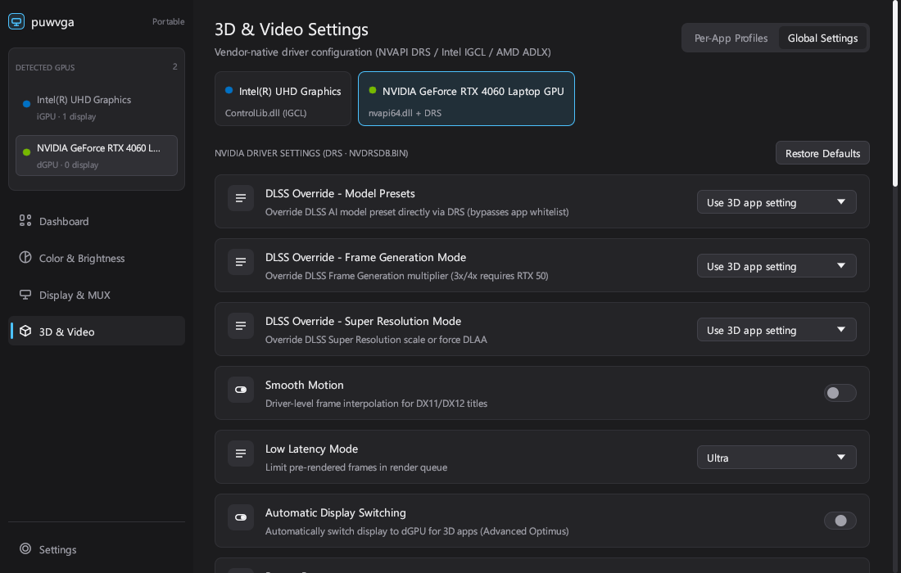

# puwvga

<p align="left">
  
</p>

**English** | [Tiếng Việt](README.md)

`puwvga` is a unified GPU configuration control panel for Windows 10 and Windows 11. It supports Intel, NVIDIA, and AMD graphics adapters inside a single native executable.

The application talks directly to the vendor libraries shipped with your graphics drivers (`ControlLib.dll`, `nvapi64.dll`, `atiadlxx.dll`) alongside native Windows display APIs (DXGI, CCD, and Gamma Ramp). The UI is written in Rust (`eframe`/`egui`) with a statically linked VC++ runtime, no WebView dependency, and no background service after you close the window.

## Screenshots

### Hardware overview


### Color and brightness



### 3D and Video settings



## Features

### Hardware detection and display mapping

`puwvga` detects every installed GPU on single-GPU desktops and dual-GPU laptops (iGPU plus dGPU), then maps each active display to the adapter driving it.

### Color and brightness

- Adjust Brightness, Contrast, Gamma, Saturation or Digital Vibrance, and Hue per display.
- Intel: writes Saturation and Hue directly to the hardware 3x3 CSC matrix block via `ctlPixelTransformationSetConfig`, toggles Dynamic Contrast Enhancement (LACE) via IGCL, and applies Brightness, Contrast, and Gamma through the display LUT.
- NVIDIA: reads and writes Digital Vibrance directly via `NvAPI_GetDVCInfoEx` and `NvAPI_SetDVCLevelEx`.
- Configure output wire format including Color Depth, Color Format (RGB/YCbCr), and Dynamic Range (Full 0-255 or Limited 16-235).

### Display modes, spanning, and MUX

- Change resolution and refresh rate (Windows CCD, with a 15-second auto-revert if unconfirmed).
- Scaling: Intel goes through IGCL (including Retro/Integer Scaling), NVIDIA and AMD through Windows CCD. Intel Sharpness uses IGCL. NVIDIA G-SYNC uses DRS (`VRR_MODE`). Intel VRR and AMD FreeSync have no switch API wired yet, so they are locked.
- Show the current MUX / Optimus routing on dual-GPU laptops. NVIDIA has no public API to switch the MUX, so this is read-only.
- Multi-display spanning (NVIDIA Mosaic, Intel Combined Display, AMD Eyefinity) only previews the layout for now. The driver spanning calls have not been verified on a multi-monitor machine, so the switch is locked.

### Vendor-native 3D and Video settings

- NVIDIA (`nvapi64.dll` and DRS `nvdrsdb.bin`): supports Global and Per-App profiles with 20 Driver Settings (DLSS Override, Smooth Motion, Low Latency Mode, DSR, Image Scaling, RTX Dynamic Vibrance, RTX HDR, and more), 11 collapsible Legacy Settings, and 3 Video settings.
- Intel (`ControlLib.dll` IGCL): queries hardware capability flags for 3D features (Flip Mode/VSync, Low Latency, Frame Limit, CMAA, Adaptive Tessellation, Sharpening, Endurance Gaming) and Video Processing (Super Resolution, Film Mode, Denoise, Adaptive Sharpening).
- AMD (`atiadlxx.dll` ADL2): sets saturation, hue, and color temperature on the selected display through `ADL2_Display_Color_Set`, within the range the driver reports. It follows the ADL SDK but has not been tested on AMD hardware yet. AMD 3D Gaming and Video options are only stored in the preset for now and are not written to the driver.

### Interface, localization, and presets

- Dark and Light themes synchronized with Windows 11.
- Instant language switching between Vietnamese and English in Settings.
- Changes are saved automatically to `puwvga.presets.json` next to the executable (falling back to `%APPDATA%\puwvga\` when the install folder is read-only) and restored on the next launch.
- Optional Windows Task Scheduler integration (`puwvga_ApplyColor` running `puwvga.exe --apply-only` on logon and session unlock) re-applies color settings automatically and exits immediately with no background process.

## Intentional omissions

`puwvga` focuses strictly on display and driver configuration. It does not load `nvml.dll`, poll hardware telemetry (temperatures, clocks, power, or fan speeds), inject overlays, record video, require an account, overclock hardware, or edit game config files.

## Download and installation

Prebuilt binaries are published on the [Releases](https://github.com/erikpuw/puwvga/releases) page:

- `puwvga-v1.0.4-portable-x64.exe`: standalone portable executable, no installation required.
- `puwvga-setup-v1.0.4-x64.exe`: Windows installer that creates Start Menu and Desktop shortcuts and registers an uninstaller in Windows Settings (Apps).

Note: release binaries are currently unsigned. Windows SmartScreen may show a "Windows protected your PC" prompt on the first launch. Choose **More info** and click **Run anyway** to proceed.

## Workspace layout

- `crates/puwvga-core`: shared data models, `GpuBackend` trait, `SettingDescriptor` schema, VI/EN strings, and JSON preset persistence.
- `crates/puwvga-win32`: DXGI GPU enumeration, Win32 CCD display mapping and mode switching, Gamma Ramp read/write, and Windows theme detection.
- `crates/puwvga-intel`: dynamic FFI loader for `ControlLib.dll` (Intel IGCL).
- `crates/puwvga-nvidia`: dynamic FFI loader for `nvapi64.dll` and DRS `nvdrsdb.bin`.
- `crates/puwvga-amd`: dynamic FFI loader for `atiadlxx.dll` (AMD ADL2).
- `crates/puwvga-ui`: native Rust GUI (`eframe`/`egui`).
- `crates/puwvga-installer`: native Rust Windows installer and uninstaller.
- `installer/puwvga.iss`: optional Inno Setup 6 packaging script.

## Building from source

Requires the Rust toolchain with target `x86_64-pc-windows-msvc` and the Windows 10/11 SDK (`rc.exe`). `.cargo/config.toml` enables `-C target-feature=+crt-static` so the VC++ runtime is linked statically.

```powershell
# Run all unit tests
cargo test --workspace

# Build the portable executable
cargo build --release -p puwvga-ui

# Build the Windows installer (after building puwvga-ui)
cargo build --release -p puwvga-installer
```

## License

Licensed under the [Apache License 2.0](LICENSE).
