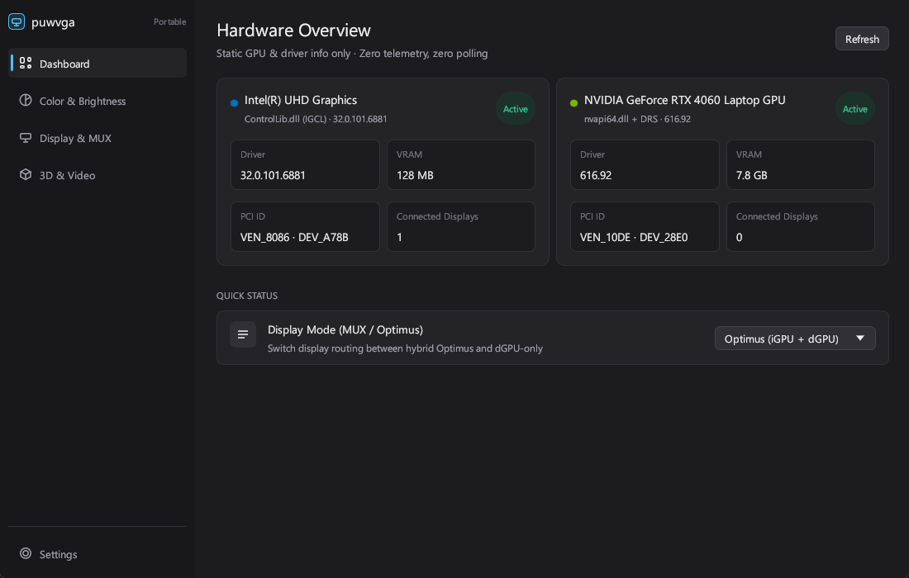

<p align="center">
  
</p>

<h1 align="center">puwvga</h1>

<p align="center"><b>One control panel for Intel, NVIDIA and AMD.</b></p>

<p align="center">
  Color, resolution, scaling, Display Mode (MUX) and each vendor's 3D settings, in a single window.<br>
  Written in Rust, ~2.3 MB installer, no WebView, nothing left running in the background, no Visual C++ Redistributable needed.
</p>

<p align="center"><a href="README.md">Tiếng Việt</a> · <b>English</b> · <a href="https://github.com/erikpuw/puwvga/releases/latest"></a></p>

> I got tired of every GPU vendor having its own control panel, so the idea was to bring all the settings into one place.
>
> erikpuw

> **Download only from the author.** puwvga is published by its author (erikpuw) only at [github.com/erikpuw/puwvga](https://github.com/erikpuw/puwvga). Copies from anywhere else (download sites, other repositories, repackaged builds, files passed around online) are outside the author's control and not guaranteed: they may have been modified or had code injected. Use only the builds under this repository's [Releases](https://github.com/erikpuw/puwvga/releases).



## Features

| Feature | What it does |
|---|---|
| **GPU detection** | Finds every GPU in the machine (single-GPU desktop or iGPU + dGPU laptop) and maps each display to the GPU that drives it. |
| **Color** | Brightness, contrast and gamma through the Windows gamma ramp, for every vendor. Saturation and hue through the driver: Intel IGCL's HueSat block, NVIDIA Digital Vibrance, AMD `ADL2_Display_Color_Set`. Intel also gets LACE (Dynamic Contrast Enhancement). |
| **Color follows the panel** | Color settings are stored per panel EDID, not per GPU. After a MUX switch, coming back to the app re-applies them on the new GPU. |
| **Display Mode (MUX)** | Pick Auto, Optimus or NVIDIA GPU and it switches right away, like NVIDIA App's Apply button. Requires NVIDIA App; without it the app opens NVIDIA Control Panel. |
| **Resolution** | Changes resolution and refresh rate through Windows CCD, with a 15-second auto-revert if you don't confirm. |
| **Scaling, Sharpness** | Intel: scaling, Retro/Integer Scaling and sharpness through IGCL. NVIDIA and AMD: scaling through Windows CCD. |
| **G-SYNC** | Turns global G-SYNC on or off through DRS (`VRR_MODE`). |
| **NVIDIA 3D settings** | Written straight to DRS, with IDs and values checked against the driver itself: VSync, Low Latency, Max FPS, Background FPS, power management, texture filtering, anisotropic filtering, Threaded Optimization, Shader Cache, FXAA, DLSS Override (preset, Super Resolution, Frame Generation). |
| **Intel 3D settings** | Reads hardware capability flags for Flip Mode/VSync, Low Latency, Frame Limit, CMAA, Adaptive Tessellation, Sharpening, Endurance Gaming and the Video Processing group. |
| **Auto-apply color** | The `puwvga_ApplyColor` Task Scheduler task runs `puwvga.exe --apply-only` on logon and unlock, applies color and exits. |
| **Two languages, light and dark** | Switch between Tiếng Việt and English in Settings. Light and dark theme follow Windows 11. |
| **Presets** | Every change is saved to `puwvga.presets.json` next to the exe, or `%APPDATA%\puwvga\` when that folder is read-only. |

### Locked or not yet verified

These show up in the UI but are not written to the driver yet, or have not been tested on real hardware:

- **Display spanning** (NVIDIA Mosaic, Intel Combined Display, AMD Eyefinity): layout preview only. The driver spanning call is locked until it is tested on a multi-monitor machine.
- **Intel VRR, AMD FreeSync**: no switch API wired yet, locked.
- **AMD**: color follows the ADL SDK but has not been tested on AMD hardware. AMD 3D and Video settings are only stored in the preset.
- **Some NVIDIA items** such as Smooth Motion, DSR, RTX HDR, RTX Dynamic Vibrance and the Video group: only stored in the preset.

## Screenshots

| Color and brightness | 3D and Video |
|---|---|
|  |  |

## Install and use

1. If puwvga is already running, close it first so the installer can replace the exe.
2. Download `puwvga-setup-v*-x64.exe` (~2.3 MB) from [Releases](https://github.com/erikpuw/puwvga/releases/latest) and run it to install (creates Start Menu and Desktop shortcuts and an entry under Windows Settings > Apps for uninstalling).
3. Open the app, pick a display on the Color or Display page and adjust. Changes are saved immediately.
4. To have color re-applied after logon or unlock, turn on **Auto-apply color on logon and unlock** in Settings.

Releases are not code-signed yet. On first run Windows SmartScreen may show "Windows protected your PC": choose **More info**, then **Run anyway** if you downloaded it from this repository.

## What puwvga does not do

puwvga only configures displays and drivers. It does not load `nvml.dll`, read temperatures, clocks or fan speeds, draw an overlay, record the screen, ask for an account, overclock, or edit game config files. Closing the window exits the app.

## Source layout

| Crate | Role |
|---|---|
| `puwvga-core` | Data model, `GpuBackend` trait, `SettingDescriptor`, VI/EN strings, preset JSON. |
| `puwvga-win32` | DXGI, Windows CCD (resolution, scaling, display mapping), gamma ramp, theme, Task Scheduler. |
| `puwvga-intel` | Loads `ControlLib.dll` (Intel IGCL) at runtime. |
| `puwvga-nvidia` | Loads `nvapi64.dll`, DRS, and NVIDIA App's `NvCpl.dll` for Display Mode. |
| `puwvga-amd` | Loads `atiadlxx.dll` (AMD ADL2) at runtime. |
| `puwvga-ui` | `eframe`/`egui` user interface. |
| `puwvga-installer` | Installer and uninstaller written in Rust. |

`installer/puwvga.iss` is a backup Inno Setup 6 script for packaging.

## Building

You need the Rust `x86_64-pc-windows-msvc` target and the Windows 10/11 SDK (`rc.exe`). `.cargo/config.toml` already sets `-C target-feature=+crt-static` to link the VC++ runtime statically.

```powershell
# Run all tests
cargo test --workspace

# Build the app
cargo build --release -p puwvga-ui

# Build the installer (after building puwvga-ui)
cargo build --release -p puwvga-installer
```

## License

[Apache License 2.0](LICENSE).
