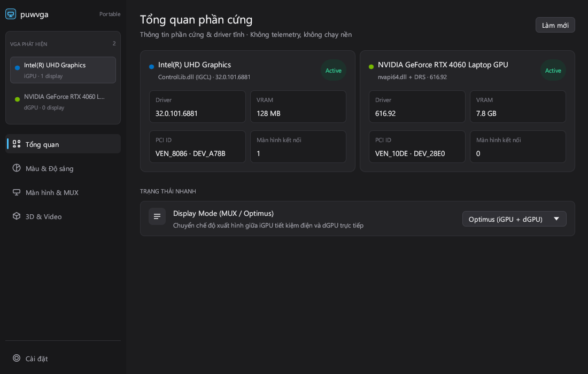

# puwvga

<p align="left">
  
</p>

[English](README.en.md) | **Tiếng Việt**

`puwvga` là ứng dụng điều khiển cấu hình VGA tập trung cho Windows 10 và Windows 11, hỗ trợ đồng thời ba hãng Intel, NVIDIA và AMD trong một chương trình duy nhất.

Ứng dụng giao tiếp trực tiếp với các thư viện chính thức có sẵn trong driver (`ControlLib.dll`, `nvapi64.dll`, `atiadlxx.dll`) và các API hiển thị của Windows (DXGI, CCD, Gamma Ramp). Phần giao diện viết bằng Rust (`eframe`/`egui`), liên kết tĩnh VC++ Runtime, không dùng WebView và không chạy tiến trình nền sau khi đóng cửa sổ.

## Ảnh chụp giao diện

### Tổng quan phần cứng



### Màu sắc và độ sáng


### Cấu hình 3D và Video


## Tính năng

### Nhận diện phần cứng và ánh xạ màn hình

Ứng dụng tự phát hiện toàn bộ GPU có trên máy, bao gồm cấu hình máy bàn 1 VGA hoặc laptop 2 GPU (iGPU và dGPU), sau đó ánh xạ từng màn hình đang hoạt động tới đúng GPU chủ quản.

### Màu sắc và độ sáng

- Điều chỉnh Brightness, Contrast, Gamma, Saturation hoặc Digital Vibrance, và Hue theo từng màn hình.
- Trên Intel: ghi trực tiếp Saturation và Hue xuống khối ma trận màu CSC 3x3 của driver qua `ctlPixelTransformationSetConfig`, bật/tắt Dynamic Contrast Enhancement (LACE) qua IGCL, và điều chỉnh Brightness/Contrast/Gamma qua LUT phần cứng.
- Trên NVIDIA: đọc và ghi trực tiếp Digital Vibrance qua `NvAPI_GetDVCInfoEx` và `NvAPI_SetDVCLevelEx`.
- Chọn định dạng tín hiệu màu đầu ra gồm Output Color Depth, Color Format (RGB/YCbCr) và Dynamic Range (Full 0-255 / Limited 16-235).

### Màn hình, ghép màn hình và MUX

- Đổi độ phân giải, tần số quét, chế độ Scaling, Sharpness (Intel) và VRR / G-SYNC / FreeSync.
- Chuyển chế độ xuất hình MUX / Optimus trên laptop có 2 GPU.
- Ghép nhiều màn hình (NVIDIA Mosaic/Surround, Intel Combined Display, AMD Eyefinity SLS) kèm bộ đếm ngược tự hoàn tác 15 giây nếu người dùng chưa xác nhận.

### Cấu hình 3D và Video theo từng hãng

- NVIDIA (`nvapi64.dll` và DRS `nvdrsdb.bin`): hỗ trợ Global và Per-App với 20 mục Driver Settings (DLSS Override, Smooth Motion, Low Latency Mode, DSR, Image Scaling, RTX Dynamic Vibrance, RTX HDR...), 11 mục Legacy Settings thu gọn được, và 3 mục Video.
- Intel (`ControlLib.dll` IGCL): đọc cờ hỗ trợ trực tiếp từ phần cứng cho các tính năng 3D (Flip Mode/VSync, Low Latency, Frame Limit, CMAA, Adaptive Tessellation, Sharpening, Endurance Gaming) và Video Processing (Super Resolution, Film Mode, Denoise, Adaptive Sharpening).
- AMD (`atiadlxx.dll` ADLX): hỗ trợ Global và Per-App cho nhóm 3D Gaming (Radeon Anti-Lag, Chill, Boost, RIS, Enhanced Sync, Vertical Refresh, FRTC, Texture Quality, Surface Format Optimization, Tessellation) và Video.

### Giao diện, song ngữ và lưu cấu hình

- Giao diện tối và sáng đồng bộ với Windows 11.
- Chuyển đổi trực tiếp giữa Tiếng Việt và English trong mục Cài đặt.
- Mọi thay đổi được tự động lưu vào `puwvga.presets.json` đặt cạnh file `.exe` (tự chuyển sang `%APPDATA%\puwvga\` nếu thư mục cài đặt chỉ đọc) và khôi phục lại ở lần mở tiếp theo.
- Hỗ trợ tùy chọn tự áp màu cùng Windows qua Task Scheduler (`puwvga_ApplyColor` gọi `puwvga.exe --apply-only` khi đăng nhập hoặc mở khóa máy, áp xong thoát ngay, không chạy tiến trình nền).

## Phạm vi loại trừ

`puwvga` chỉ làm nhiệm vụ cấu hình hiển thị và driver. Ứng dụng không nạp `nvml.dll`, không đọc cảm biến nhiệt độ, xung nhịp hay tốc độ quạt chạy nền, không có lớp phủ overlay, không quay màn hình, không yêu cầu đăng nhập tài khoản, không ép xung và không tự chỉnh file cấu hình game.

## Cài đặt và sử dụng

Bạn có thể tải bản phát hành mới nhất tại mục [Releases](https://github.com/erikpuw/puwvga/releases):

- `puwvga-v1.0.4-portable-x64.exe`: chạy trực tiếp, không cần cài đặt.
- `puwvga-setup-v1.0.4-x64.exe`: bản cài đặt vào máy, tạo lối tắt Start Menu, Desktop và mục gỡ cài đặt trong Windows Settings (Apps).

Lưu ý: các bản dựng hiện tại chưa có chữ ký số (unsigned). Windows SmartScreen có thể hiển thị cảnh báo "Windows protected your PC" ở lần chạy đầu tiên; chọn **More info** rồi nhấn **Run anyway** nếu bạn tin cậy bản phát hành từ kho mã nguồn này.

## Cấu trúc mã nguồn

- `crates/puwvga-core`: mô hình dữ liệu, trait `GpuBackend`, schema cấu hình `SettingDescriptor`, song ngữ VI/EN và lưu Preset JSON.
- `crates/puwvga-win32`: liệt kê GPU qua DXGI, ánh xạ màn hình và đổi độ phân giải/Hz qua Win32 CCD, đọc/ghi Gamma Ramp và đọc theme Windows.
- `crates/puwvga-intel`: FFI động nạp `ControlLib.dll` (Intel IGCL).
- `crates/puwvga-nvidia`: FFI động nạp `nvapi64.dll` và DRS `nvdrsdb.bin`.
- `crates/puwvga-amd`: FFI động nạp `atiadlxx.dll` (AMD ADL/ADLX).
- `crates/puwvga-ui`: giao diện ứng dụng viết bằng Rust (`eframe`/`egui`).
- `crates/puwvga-installer`: trình cài đặt và gỡ cài đặt Windows viết bằng Rust thuần.
- `installer/puwvga.iss`: script Inno Setup 6 bổ sung cho quy trình đóng gói.

## Tự build từ mã nguồn

Yêu cầu Rust toolchain target `x86_64-pc-windows-msvc` và Windows 10/11 SDK (`rc.exe`). File `.cargo/config.toml` đã bật sẵn `-C target-feature=+crt-static` để nhúng tĩnh VC++ Runtime.

```powershell
# Chạy toàn bộ unit test
cargo test --workspace

# Build file chạy portable
cargo build --release -p puwvga-ui

# Build trình cài đặt (sau khi đã build puwvga-ui)
cargo build --release -p puwvga-installer
```

## Giấy phép

Dự án phát hành theo giấy phép [Apache License 2.0](LICENSE).
