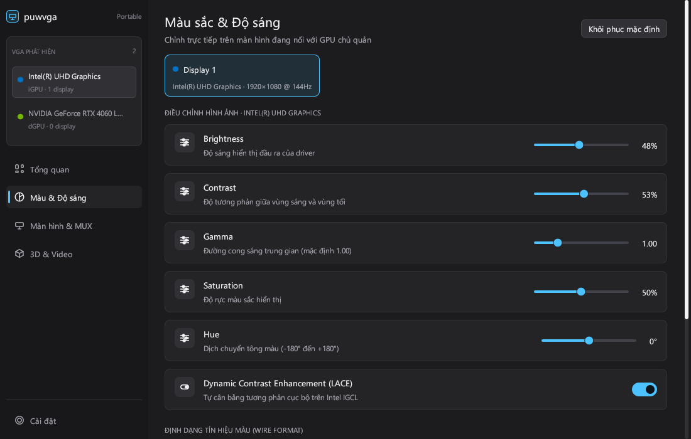
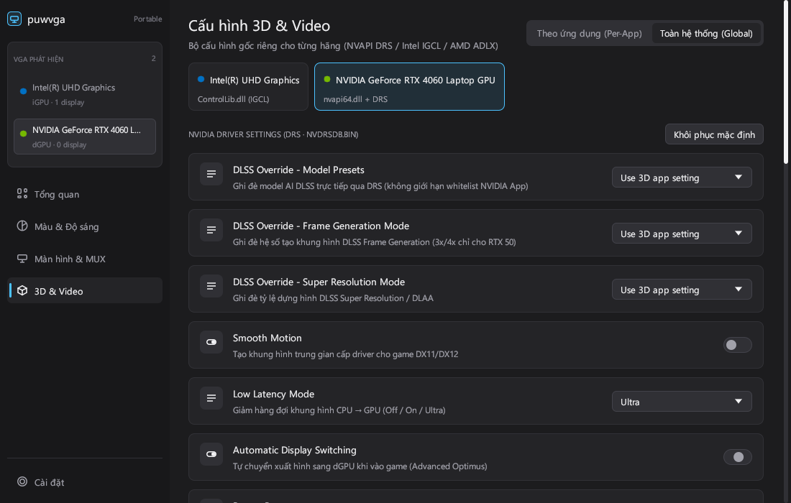

<p align="center">
  
</p>

<h1 align="center">puwvga</h1>

<p align="center"><b>Một bảng điều khiển cho cả Intel, NVIDIA và AMD.</b></p>

<p align="center">
  Màu sắc, độ phân giải, scaling, Display Mode (MUX) và thiết lập 3D của từng hãng, gom vào một cửa sổ.<br>
  Viết bằng Rust, bộ cài ~2,3 MB, không WebView, không chạy nền, không cần cài Visual C++ Redistributable.
</p>

<p align="center"><b>Tiếng Việt</b> · <a href="README.en.md">English</a> · <a href="https://github.com/erikpuw/puwvga/releases/latest"></a></p>

> Tôi mệt mỏi với các điều khiển VGA của từng hãng, nên ý tưởng xuất phát các điều chỉnh về một nơi.
>
> erikpuw

> **Chỉ tải từ nguồn của tác giả.** puwvga do tác giả (erikpuw) phát hành duy nhất tại [github.com/erikpuw/puwvga](https://github.com/erikpuw/puwvga). Bản tải từ nơi khác (trang chia sẻ, kho khác, bản đóng gói lại, tệp gửi qua mạng) không do tác giả kiểm soát và không được đảm bảo: có thể đã bị sửa đổi hoặc chèn thêm mã. Hãy chỉ dùng bản ở mục [Releases](https://github.com/erikpuw/puwvga/releases) của kho này.


## Tính năng

| Tính năng | Làm gì |
|---|---|
| **Nhận diện GPU** | Tìm mọi GPU trên máy (máy bàn 1 VGA hoặc laptop iGPU + dGPU) và gán từng màn hình cho đúng GPU đang xuất hình. |
| **Màu sắc** | Brightness, Contrast, Gamma qua Gamma Ramp của Windows, áp cho mọi hãng. Saturation và Hue qua driver: khối HueSat của Intel IGCL, Digital Vibrance của NVIDIA, `ADL2_Display_Color_Set` của AMD. Intel có thêm LACE (Dynamic Contrast Enhancement). |
| **Màu đi theo màn** | Cấu hình màu lưu theo định danh EDID của tấm nền, không theo GPU. Đổi MUX xong quay lại app thì màu được áp lại lên GPU mới. |
| **Display Mode (MUX)** | Chọn Auto, Optimus hoặc NVIDIA GPU là chuyển ngay, giống nút Apply của NVIDIA App. Cần cài NVIDIA App; không có thì app mở NVIDIA Control Panel. |
| **Độ phân giải** | Đổi độ phân giải và tần số quét qua Windows CCD, tự hoàn tác sau 15 giây nếu chưa xác nhận. |
| **Scaling, Sharpness** | Intel: Scaling, Retro/Integer Scaling và Sharpness qua IGCL. NVIDIA và AMD: Scaling qua Windows CCD. |
| **G-SYNC** | Bật tắt G-SYNC toàn cục qua DRS (`VRR_MODE`). |
| **Thiết lập 3D NVIDIA** | Ghi thẳng vào DRS với ID và giá trị đã đối chiếu từ chính driver: VSync, Low Latency, Max FPS, Background FPS, Power management, Texture filtering, Anisotropic, Threaded Optimization, Shader Cache, FXAA, DLSS Override (preset, Super Resolution, Frame Generation). |
| **Thiết lập 3D Intel** | Đọc cờ hỗ trợ từ phần cứng cho Flip Mode/VSync, Low Latency, Frame Limit, CMAA, Adaptive Tessellation, Sharpening, Endurance Gaming và nhóm Video Processing. |
| **Tự áp màu** | Tác vụ Task Scheduler `puwvga_ApplyColor` chạy `puwvga.exe --apply-only` khi đăng nhập hoặc mở khóa máy, áp màu xong thoát ngay. |
| **Song ngữ, sáng tối** | Tiếng Việt / English đổi ngay trong Cài đặt. Giao diện sáng tối theo Windows 11. |
| **Preset** | Mọi thay đổi tự lưu vào `puwvga.presets.json` cạnh file exe, hoặc `%APPDATA%\puwvga\` nếu thư mục chỉ đọc. |

### Còn khóa hoặc chưa kiểm chứng

Những mục dưới đây hiện trong giao diện nhưng chưa ghi xuống driver, hoặc chưa được thử trên máy thật:

- **Ghép màn hình** (NVIDIA Mosaic, Intel Combined Display, AMD Eyefinity): mới có phần xem trước bố cục. Lệnh ghép qua driver đang khóa vì chưa thử trên máy nhiều màn hình.
- **VRR trên Intel, FreeSync trên AMD**: chưa có API bật tắt, đang khóa.
- **AMD**: phần màu viết theo ADL SDK nhưng chưa thử trên máy AMD thật. Thiết lập 3D và Video của AMD mới chỉ lưu trong preset.
- **Một số mục NVIDIA** như Smooth Motion, DSR, RTX HDR, RTX Dynamic Vibrance và nhóm Video: mới chỉ lưu trong preset.

## Ảnh chụp

| Màu sắc và độ sáng | Cấu hình 3D và Video |
|---|---|
|  |  |

## Cài đặt và dùng

1. Nếu puwvga đang mở, đóng app trước khi chạy bộ cài để ghi đè file.
2. Tải `puwvga-setup-v*-x64.exe` (~2,3 MB) từ mục [Releases](https://github.com/erikpuw/puwvga/releases/latest) rồi chạy để cài đặt (có lối tắt Start Menu, Desktop và mục gỡ cài trong Windows Settings).
3. Mở app, chọn màn hình ở trang Màu sắc hoặc Màn hình rồi chỉnh. Thay đổi được lưu ngay.
4. Muốn màu tự áp lại sau khi đăng nhập hoặc mở khóa máy, bật **Tự áp màu khi đăng nhập và mở khóa máy** trong Cài đặt.

Bản phát hành chưa có chữ ký số. Lần chạy đầu Windows SmartScreen có thể hiện "Windows protected your PC": chọn **More info** rồi **Run anyway** nếu bạn tải từ kho này.

## puwvga không làm gì

puwvga chỉ cấu hình hiển thị và driver. App không nạp `nvml.dll`, không đọc nhiệt độ, xung nhịp hay tốc độ quạt, không có overlay, không quay màn hình, không cần đăng nhập tài khoản, không ép xung và không sửa file cấu hình game. Đóng cửa sổ là thoát hẳn.

## Cấu trúc mã nguồn

| Crate | Vai trò |
|---|---|
| `puwvga-core` | Mô hình dữ liệu, trait `GpuBackend`, `SettingDescriptor`, song ngữ VI/EN, Preset JSON. |
| `puwvga-win32` | DXGI, Windows CCD (độ phân giải, scaling, ánh xạ màn hình), Gamma Ramp, theme, Task Scheduler. |
| `puwvga-intel` | Nạp động `ControlLib.dll` (Intel IGCL). |
| `puwvga-nvidia` | Nạp động `nvapi64.dll`, DRS và `NvCpl.dll` của NVIDIA App cho Display Mode. |
| `puwvga-amd` | Nạp động `atiadlxx.dll` (AMD ADL2). |
| `puwvga-ui` | Giao diện `eframe`/`egui`. |
| `puwvga-installer` | Trình cài và gỡ cài viết bằng Rust. |

`installer/puwvga.iss` là script Inno Setup 6 dự phòng cho việc đóng gói.

## Tự build

Cần Rust target `x86_64-pc-windows-msvc` và Windows 10/11 SDK (`rc.exe`). `.cargo/config.toml` đã bật `-C target-feature=+crt-static` để nhúng tĩnh VC++ Runtime.

```powershell
# Chạy toàn bộ test
cargo test --workspace

# Build ứng dụng
cargo build --release -p puwvga-ui

# Build trình cài đặt (sau khi đã build puwvga-ui)
cargo build --release -p puwvga-installer
```

## Giấy phép

[Apache License 2.0](LICENSE).
